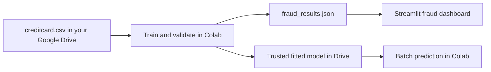

# Train credit-card fraud detection in Colab

Your dataset uses the standard **creditcard.csv** layout: `Class=0` is legitimate, `Class=1` is fraud, with numerical `V1`–`V28`, `Amount`, and `Time` features.

The recommended architecture for the full file is:



Streamlit remains a lightweight analysis interface. The complete transaction CSV never needs to be uploaded to it. This avoids its 25 MB upload and 50,000-row local training limits without raising those limits and exhausting the application server.

## Step-by-step

1. Upload `creditcard.csv` to your Google Drive, for example in **My Drive**. Keep private financial/customer data in storage you are authorized to use; the repository contains no real transaction data.
2. [Open the fraud notebook in Google Colab](https://colab.research.google.com/github/abbk1/ML-Analytics/blob/main/examples/credit_card_fraud_colab.ipynb). You can also download it from the application's **Credit Card Fraud & Colab** or **Import Colab Results** page and open it in Colab.
3. Run the dependency cell. If Colab asks to restart after installation, restart the session once and continue with the following cells. A CPU runtime is enough; the scikit-learn ANN/Random Forest implementation does not use a GPU.
4. Run the Drive-mount cell and authorize access in Colab. This happens in your browser; no Google credentials are entered into Streamlit or committed to GitHub.
5. Set `csv_path="/content/drive/MyDrive/creditcard.csv"`. Set `output_dir` to a new folder in Drive for each experiment. The notebook's timestamped default does this automatically.
6. Choose the appropriate mode below and run training. The notebook prints actual completed candidates or epochs, not estimated progress. Training may take minutes or longer depending on the runtime and parameters.
7. Find **fraud_results.json** in the output folder. Download it through Drive/Colab, open the deployed app's **Import Colab Results** page, and click **Validate and import** after choosing that JSON file. Do not upload the full CSV or Joblib model into the import page.
8. Open **Credit Card Fraud & Colab**, **Performance Evaluation**, and **Export and Reports**. Inspect fraud missed/detected, legitimate transactions flagged/cleared, fraud recall, false alarm rate, average precision, confusion matrices, ROC/PR curves, and validation-only model comparison.

## Choose a training mode

| Mode | When to use | Models | Memory behavior |
|---|---|---|---|
| `batch` | Full file fits your Colab RAM | Random Forest, ANN/MLP, SGD logistic, Dummy baseline | Reads the full numeric dataset; checks estimated array copies against an explicit budget. Estimators need additional RAM. |
| `incremental` | Full file cannot fit RAM | SGD logistic only | Multiple chunked passes over the complete Time-sorted CSV; never loads the full feature matrix. Validation/test labels and probabilities are still collected within an explicit row budget. |

### Batch ANN versus Random Forest

The notebook defaults to `models=("Random Forest", "MLP", "Dummy baseline")`. Every candidate uses the same training and validation observations. Class weighting addresses imbalance without expanding all fraud examples to majority-class size. The ANN is an MLP with 64/32 hidden neurons, scaled inputs and balanced training sample weights. The forest has bounded depth, 80 trees by default, and balanced-subsample class weights. Training is sequential with at most two workers/native threads.

The code checks approximately six copies of the raw numerical arrays against `memory_budget_mb` (default 1024 MB). This is a guard, not a guarantee: tree objects, neural-network workspaces, pandas parsing and the notebook also use RAM. If Colab runs out of memory, lower `rf_estimators`/`mlp_iterations`, choose incremental mode, or use a suitable larger runtime. The script never silently samples your file to make a run pass.

### Incremental full-file training

Set:

```python
config = FraudColabConfig(
    csv_path="/content/drive/MyDrive/creditcard.csv",
    output_dir="/content/drive/MyDrive/fraud_results/new_incremental_run",
    mode="incremental",
    split_method="chronological",
    chunk_size=50000,
    epochs=3,
    max_evaluation_rows=1000000,
)
result = run_fraud_experiment(config)
```

The CSV must already be sorted by nondecreasing `Time`. The common creditcard.csv is usually time-ordered, but the script checks rather than assuming. An unsorted file is rejected. Sorting a file larger than RAM requires an external/disk-based sort or a suitable larger runtime; the script does not claim to solve that prerequisite.

The passes audit timestamps/counts, locate the boundaries, learn a StandardScaler from **training chunks only**, and then update an SGD logistic classifier once per training row per epoch. Missing numerical values use an explicit **fixed zero fill**; incremental mode does not approximate a whole-dataset median. Class weights are calculated from training counts only. Validation and test rows never update the scaler, weights or classifier.

This mode is a different model family; it is **not** incremental ANN or Random Forest. Choosing it trades those comparisons for lower feature-memory use. Validation/test responses are much smaller than the feature matrix but still use RAM. Each partition is capped at `max_evaluation_rows` (default one million). If exceeded, the script stops: increase the explicit budget only on a suitable runtime. Neither training nor evaluation is silently sampled. Runtime/disk/CPU limits still apply.

## Scientific workflow

- **Chronological split (default):** earliest 60% for training, next 20% for validation, last 20% for test. Equal timestamps stay together, so exact fractions can shift. Every partition must contain legitimate and fraudulent transactions. If not, choose a sufficiently representative time window; there is no automatic fallback to random splitting.
- **Stratified research alternative:** batch mode permits `split_method="stratified"` for an independent-record research baseline. This evaluates a different question from future-transaction detection and may be optimistic under time drift. Incremental mode requires chronological splitting.
- **Training-only preprocessing:** batch imputers/scalers and incremental scaler statistics see training data only. Class weights are training-only. No global SMOTE is used; expanding a very imbalanced dataset can consume substantial memory and change calibration.
- **Candidate selection:** choose by **validation average precision**. The notebook reports every candidate's validation AP and fit time. Those are not final holdout scores.
- **Threshold selection:** on validation responses, maximize F-beta (default F2) subject to your chosen `min_precision` (default 0.10). F2 emphasizes recall. These defaults are explicit research settings; they are not business-approved costs or universal standards. If the constraint is infeasible, the run stops without looking at the test set.
- **Final test:** evaluate only the selected candidate with its frozen threshold on the untouched test partition. The selected model is not refitted afterward, preserving the fitted scaler and score scale used for threshold selection. Repeatedly tuning after inspecting the final test still compromises its independence; use a fresh confirmatory period for a final claim.
- **Metrics:** report average precision, fraud recall/F1, specificity, false positive/negative rates, balanced accuracy, macro F1, ROC-AUC, and confusion counts. AP/ROC use probabilities, never hard labels. AP is a ranking summary; it is not fraud precision at a particular threshold.

The data's `Time` is elapsed time, not necessarily a real calendar timestamp. This historical public dataset is a research benchmark and does not by itself establish production readiness, stability against fraud drift, calibration, fairness, alert handling or decision costs.

## Output files

- **fraud_results.json:** compact application import containing final test metrics, matrix, at most 400 points per ROC/PR curve, validation model/threshold results, class counts, settings, dataset SHA-256 and versions. It contains no raw transaction features or row-level predictions.
- **metrics.csv:** a small final-test metric table; import this if only metrics are needed. It has less information than the JSON.
- **validation_comparison.csv:** candidate validation AP/time for inspection in Colab. It is not an application final-test metrics import; the JSON already includes it under a separate validation section.
- **trusted_fraud_model.joblib:** fitted preprocessing/classifier, threshold, feature order and metadata. Keep it in Drive and only deserialize artifacts you created/trust. Streamlit does not accept it for loading.

Imported evaluations remain labeled external with unverified split identity. No raw CSV is needed for their fraud scorecard or charts. Very large confusion matrices are evaluated from weighted class pairs instead of expanding one row per transaction.

## Predictions on new transactions

Use the optional notebook cell with your own trusted saved bundle. Select the exact saved feature order, run `pipeline.predict_proba` on each new CSV chunk, and compare fraud probability to the **saved threshold**. Do not fit the scaler/imputer again, and do not apply the default `pipeline.predict` threshold if you selected another operating point. Save each prediction chunk to a new Drive file. The optional code is deliberately commented until you supply the new transaction path and destination.

## Persistence and limits

Saving results/models in Drive preserves finished artifacts across Colab disconnections. It does not checkpoint and resume an interrupted training run; rerun unfinished training. Google controls free Colab capacity and runtime duration, and larger files can still exceed it. The actual user's dataset has not been run by the coding agent; automated validation uses small, clearly synthetic credit-card-shaped data. No real fraud-performance numbers are fabricated.

For a small local prototype, upload a file that fits the app limits and click **Apply credit-card fraud preset**. That selects `Class`, positive label `1`, AP ranking, standard scaling, three CV folds, class-weighted forest/logistic regression and a Dummy baseline, without removing/resampling rows. Local app training remains stratified CV, not the notebook's chronological validation design; compare them with that distinction in mind.
